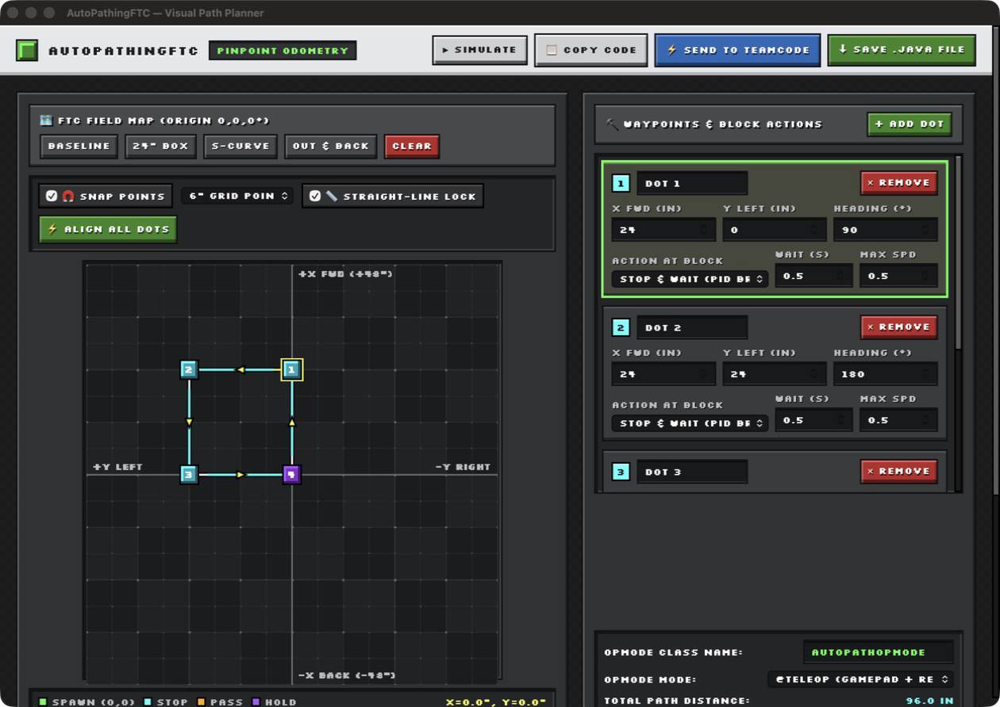
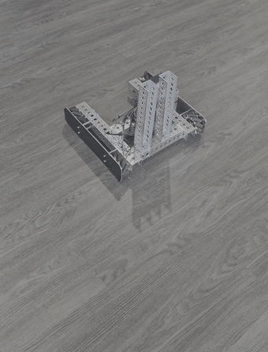
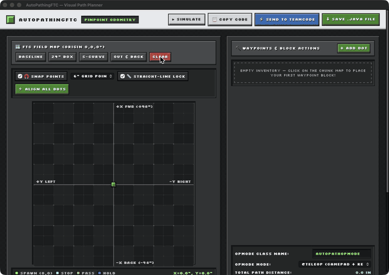
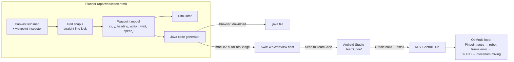

<div align="center">

# AutoPathingFTC

**Click-to-path autonomous planner for FIRST Tech Challenge robots. Draw a path, export a ready-to-run Java OpMode.**


<!-- MEDIA: Hero screenshot (recommended 1600×1000). Save as docs/media/hero.png -->


</div>

---

## Table of Contents
- [Overview](#overview)
- [Key Features](#key-features)
- [Tech Stack & Architecture](#tech-stack--architecture)
- [Getting Started](#getting-started)
- [Usage](#usage)
- [Configuration](#configuration)
- [Project Structure](#project-structure)
- [Roadmap](#roadmap)
- [License & Author](#license--author)

---

## Overview

Writing FTC autonomous routines by hand usually means guessing coordinates, recompiling, redeploying, and re-testing until the robot ends up roughly where you wanted it. **AutoPathingFTC turns that loop into a visual one:**

1. **Draw:** Click on a top-down field map to drop waypoints. Then drag them, snap them to a grid, and set a heading and behavior for each one.
2. **Preview:** Watch a simulated robot drive the path to catch mistakes before touching hardware.
3. **Export:** Generate a complete, self-contained `LinearOpMode` and send it straight into your Android Studio `TeamCode` folder.

**How it works under the hood:** The generated OpMode reads the robot's pose (X, Y, heading) and velocity from a **goBILDA Pinpoint** odometry computer on every loop. It rotates the field-frame error into the robot frame and runs three independent PID controllers (forward, strafe, turn). Their outputs are mixed into four mecanum wheel powers, which are then normalized. The D term uses Pinpoint's measured velocity, so the robot actively brakes into each target. Integral terms only build up within a few inches of the target and are clamped, which corrects the last fraction of an inch without windup.

The control loop was tuned and verified on a physical competition robot (see [`teamcode/DirekAutoPath.java`](teamcode/DirekAutoPath.java)).

<!-- MEDIA: GIF of the real robot following a generated path (≤10 MB, ~720p). Save as docs/media/robot-run.gif -->
<p align="center"></p>

---

## Key Features

### Planner
- **Click-to-place waypoints** on a 96″ × 96″ workspace centered on the robot's start pose `(0, 0, 0°)`, with a drag-to-edit and numeric inspector.
- **Grid point snapping** (1″, 3″, 6″, 12″ intervals) with visible snap pegs and a live target reticle.
- **Magnetic straight-line lock:** When a dot is within 3″ of the previous dot, the next dot, or the origin, its X or Y locks to match so segments are perfectly horizontal or vertical. Hold <kbd>Shift</kbd> to force axis lock. **Align All Dots** snaps an existing path in one click.
- **Per-waypoint behavior:**
  | Action | Behavior |
  | :--- | :--- |
  | `STOP_AND_WAIT` | PID + velocity brake to ±0.20″ / ±1.0°, wait *n* seconds, continue |
  | `PASS_THROUGH` | Cruise through at full speed and hand off to the next dot within 3.5″ (no deceleration) |
  | `STOP_AND_HOLD` | Final pose lock: actively drives back if the robot is pushed |
- **Built-in simulator** animates translation and rotation using each waypoint's speed and wait settings.
- **Fully offline, zero dependencies:** A single HTML file with embedded WOFF2 pixel fonts. It works on the competition-field Wi-Fi with no internet.

### Generated OpMode
- Complete, compile-ready Java: `@TeleOp` (test mode) or `@Autonomous` (competition).
- Field-to-robot frame rotation, so strafing and turning can happen at the same time.
- Static-friction power floors per axis, so the robot doesn't stall a few inches short of a target.
- **Live gamepad tuning** with no recompiling: flip the forward/strafe/turn direction signs, reset the origin, replay the path, or float the wheels so you can push the robot by hand.

### Native macOS App
- A ~200-line Swift `WKWebView` wrapper with a JS↔native bridge.
- **Send to TeamCode** writes the `.java` file directly into your project. The folder is chosen once and remembered, and **existing files are never overwritten without confirmation.**
- Native Save dialog, clipboard integration, and standard Edit menu shortcuts.

<!-- MEDIA: GIF of placing dots with grid snap + straight-line lock guides (~15 s). Save as docs/media/snapping.gif -->
<p align="center"></p>

---

## Tech Stack & Architecture

| Layer | Technology |
| :--- | :--- |
| Planner UI | HTML5 Canvas, vanilla JavaScript, CSS (Ore-UI-inspired block theme) |
| Desktop wrapper | Swift, Cocoa, WebKit (`WKWebView`, `WKScriptMessageHandler`) |
| Robot code | Java, FTC SDK 12.0 (`LinearOpMode`, `DcMotorEx`, `GoBildaPinpointDriver`) |
| Hardware | REV Control Hub · goBILDA Pinpoint Odometry Computer · 2× goBILDA 4-Bar odometry pods · 4-motor mecanum drivetrain |
| Build | `swiftc` + `codesign` via a shell script (no Xcode project needed) |



**Coordinate convention** (matches Pinpoint defaults once the pods are configured):

| Axis | Positive direction | On the planner map |
| :--- | :--- | :--- |
| `X` | Robot forward | Up |
| `Y` | Robot left | Left |
| Heading | Counter-clockwise | Counter-clockwise |

---

## Getting Started

### Prerequisites
| Requirement | Version | Needed for |
| :--- | :--- | :--- |
| Any modern browser | Chrome / Safari / Firefox / Edge | Web planner |
| macOS | 12 Monterey or later | Native app |
| Xcode Command Line Tools (`swiftc`) | Swift 5.7+ | Building the native app |
| Android Studio + FTC SDK | Tested on SDK 12.0 | Running generated OpModes |
| goBILDA Pinpoint + 2 dead-wheel pods | — | Odometry on the robot |

### Installation

```bash
# 1. Clone
git clone https://github.com/noproblemerr-web/autopathing-ftc.git
cd autopathing-ftc

# 2a. Web version: nothing to install
open app/web/index.html            # or: make serve → http://localhost:8000

# 2b. Native macOS app
xcode-select --install             # skip if swiftc is already available
cp .env.example .env               # optional: customize bundle ID / signing / install dir
make install                       # builds build/AutoPathingFTC.app and copies it to /Applications
```

> **Gatekeeper note:** Locally built apps are ad-hoc signed. If macOS blocks the first launch, right-click the app → **Open**, or set `SIGN_IDENTITY` in `.env` to your Developer ID.

---

## Usage

1. **Configure the robot once.** Open the generated code (or [`teamcode/DirekAutoPath.java`](teamcode/DirekAutoPath.java)) and match the hardware names and directions to your Robot Controller configuration (see [Configuration](#configuration)).
2. **Plan.** Click the map to add dots, then set `Heading`, `Action`, `Wait`, and `Max Spd` for each one. Use the presets (**Baseline**, **24″ Box**, **S-Curve**, **Out & Back**) as starting points.
3. **Simulate.** Press **▶ Simulate** to preview.
4. **Export.** Enter a unique **OpMode Class Name**, then:
   - **⚡ Send to TeamCode** (macOS app) writes `TeamCode/src/main/java/org/firstinspires/ftc/teamcode/<ClassName>.java`
   - **⬇ Save .java File** or **📋 Copy Code** works in any browser
5. **Deploy.** Build and run from Android Studio, select `<ClassName> (Visual Planner)` on the Driver Hub, and keep the robot still for about 1 s during INIT so the Pinpoint IMU can calibrate.

**Input → Output**

| Input | Output |
| :--- | :--- |
| Waypoints: `x`, `y` (in), `heading` (°), `action`, `wait` (s), `maxSpeed` (0.15–1.0) | A single `<ClassName>.java` `LinearOpMode` with the path embedded as a `Waypoint[] PATH` array |

**Gamepad 1 controls (generated OpMode)**

| Button | Action |
| :--- | :--- |
| <kbd>RB</kbd> / <kbd>D-pad ↑</kbd> | Replay path from waypoint 1 |
| <kbd>A</kbd> | Reset origin `(0, 0, 0°)` at the current pose and restart |
| Hold <kbd>LB</kbd> | Pause and float the wheels (push the robot by hand) |
| <kbd>X</kbd> / <kbd>Y</kbd> / <kbd>B</kbd> | Flip forward / strafe / turn direction sign |

---

## Configuration

### Environment (`.env`)
No secrets or API keys are required. `.env` only customizes the local build:

| Variable | Default | Purpose |
| :--- | :--- | :--- |
| `APP_NAME` | `AutoPathingFTC` | App bundle and executable name |
| `BUNDLE_ID` | from `Info.plist` | Reverse-DNS identifier |
| `SIGN_IDENTITY` | `-` (ad-hoc) | `codesign` identity |
| `INSTALL_DIR` | `/Applications` | Target folder for `make install` |
| `AUTOPATHING_TEAMCODE_DIR` | *(unset)* | Overrides the TeamCode folder when the app is launched from a terminal |

Inside the app, you can change the TeamCode folder at any time with **File ▸ Set TeamCode Folder…** (<kbd>⌘T</kbd>).

### Robot constants (in the generated OpMode)
```java
// Hardware names: must match your Robot Controller configuration
private static final String PINPOINT_NAME    = "odo";
private static final String FRONT_RIGHT_NAME = "motor1";
private static final String BACK_RIGHT_NAME  = "motor2";
private static final String FRONT_LEFT_NAME  = "motor3";
private static final String BACK_LEFT_NAME   = "motor4";

// Pod directions + sign multipliers: verify with the gamepad X/Y/B toggles, then hardcode
odo.setEncoderDirections(EncoderDirection.FORWARD, EncoderDirection.REVERSED);
private double forwardSign = -1.0, strafeSign = 1.0, turnSign = 1.0;
```

| Gain | Forward | Strafe | Heading |
| :--- | :--- | :--- | :--- |
| `KP` | 0.085 | 0.130 | 1.05 |
| `KI` | 0.025 | 0.045 | 0.15 |
| `KD` | 0.012 | 0.015 | 0.04 |
| Min power | 0.075 | 0.135 | 0.09 |

> These gains were tuned for one specific robot. Start with low `maxSpeed` (≈0.4) on a new drivetrain and adjust `KP` first.

---

## Project Structure

```text
autopathing-ftc/
├── app/
│   ├── web/
│   │   └── index.html            # Planner: UI, snapping, simulator, Java generator (single file, offline)
│   └── macos/
│       ├── main.swift            # WKWebView host + JS bridge (copy / save / send to TeamCode)
│       └── Info.plist
├── teamcode/
│   ├── DirekAutoPath.java        # Reference follower: verified on hardware (STOP_AND_WAIT path)
│   └── DirekAutoPathV2.java      # Experimental: full-speed PASS_THROUGH cruise mode
├── assets/
│   └── fonts/                    # Source WOFF2 fonts (embedded in index.html) + OFL licenses
├── scripts/
│   └── build-macos-app.sh        # swiftc → .app bundle → codesign → optional install
├── docs/
│   └── media/                    # Screenshots / GIFs referenced by this README
├── .env.example
├── .gitignore
├── Makefile                      # make app | install | serve | clean
├── LICENSE
├── THIRD_PARTY_NOTICES.md
└── README.md
```

---

## Roadmap

- [ ] **Path files:** Save and load paths as JSON, with undo/redo, so routines can be versioned and shared between team members.
- [ ] **Full-field mode:** A 144″ field with the season's field image overlay, absolute starting poses, and one-click red/blue alliance mirroring.
- [ ] **Smoother motion:** Trapezoidal velocity profiling and Bézier/spline segments with heading interpolation, plus live telemetry playback overlaid on the planned path (via FTC Dashboard).

---

## License & Author

Distributed under the **MIT License**. See [`LICENSE`](LICENSE).
Bundled fonts (Silkscreen, Pixelify Sans) are under the SIL Open Font License 1.1. See [`THIRD_PARTY_NOTICES.md`](THIRD_PARTY_NOTICES.md).

**Author:** [@noproblemerr-web](https://github.com/noproblemerr-web)

<sub>FIRST® and FIRST® Tech Challenge are registered trademarks of FIRST®, which is not affiliated with this project. The visual style is inspired by community "Ore UI" designs; this project is not affiliated with or endorsed by Mojang Studios or Microsoft.</sub>
